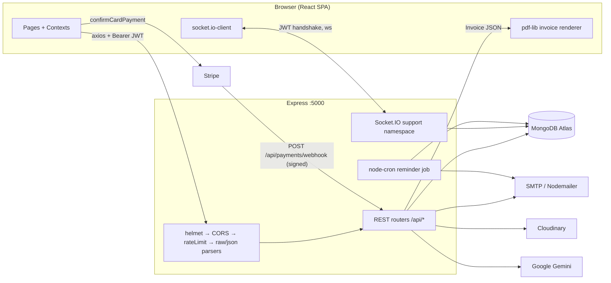
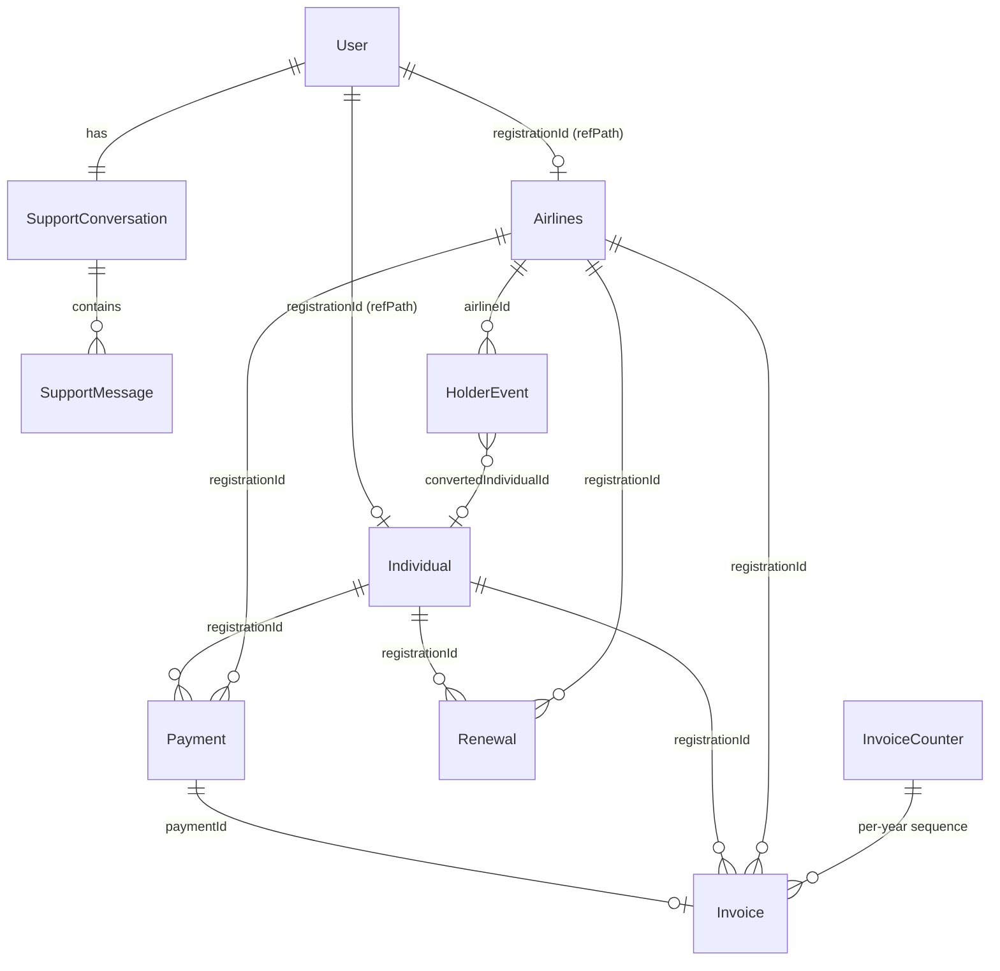
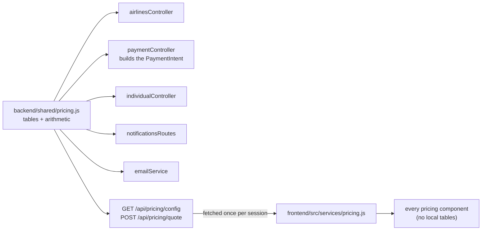
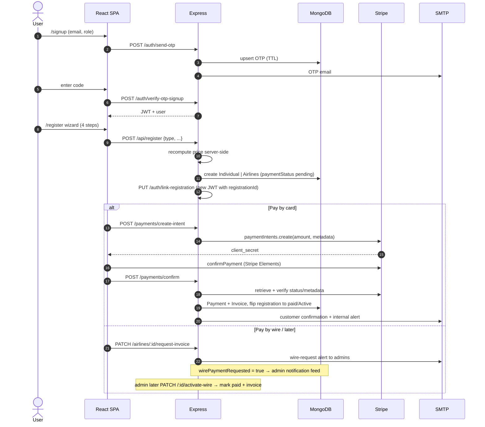
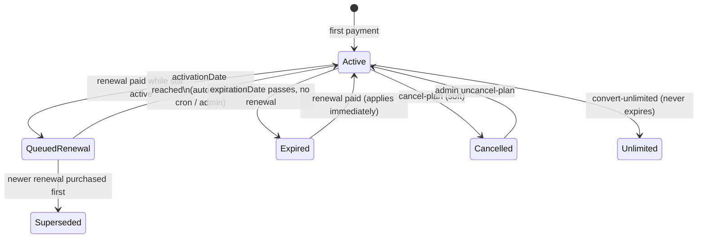

# IFOA — Agent For Services · System Architecture

**Product:** subscription platform for **IFOA (International Flight Operational Academy)**, an FAA-designated *U.S. Agent for Service*. Non-U.S. FAA certificate holders (individuals) and non-U.S. operators/airlines are legally required (14 CFR 61.13 / 65.13) to designate a U.S. agent to receive FAA correspondence. This system sells, bills, renews and administers those designations.

**Two customer types, one platform**
- **Individual** — one pilot / instructor / dispatcher, one subscription.
- **Airline / Operator** — a company with ≥3 certificate holders, a base plan plus independently-priced **holder groups** (add-on batches).

**Three actors** — `individual`, `airline`, `admin` (roles on the `User` document).

---

## 1. Tech stack

| Layer | Technology |
|---|---|
| Frontend | React 19, Vite 8, React Router 6, TailwindCSS 3, Framer Motion, `@stripe/react-stripe-js`, `pdf-lib`, `socket.io-client`, axios |
| Backend | Node.js + Express 4, Mongoose 7 (MongoDB Atlas), Socket.IO 4 |
| Auth | JWT (HS256, pinned algorithm), bcryptjs (cost 12), email OTP |
| Payments | Stripe PaymentIntents + signed webhooks; manual wire transfer path |
| Email | Nodemailer over SMTP, MJML-compiled templates |
| Files | Cloudinary (airline logos), Multer memory storage, ExcelJS / XLSX (import + export) |
| AI | Google Gemini (`@google/generative-ai`) — public support chatbot |
| Scheduling | `node-cron` — in-process expiry reminder job |
| Security | helmet, CORS allow-list, `express-rate-limit` |

---

## 2. Repository layout

```
IFOA-Agent-For-Services/
├── backend/                      # Express API + Socket.IO + cron
│   ├── server.js                 # single entry point: middleware order, routes, io, mongo
│   ├── shared/pricing.js        # THE price tables + plan arithmetic (single source)
│   ├── models/        (12)       # Mongoose schemas
│   ├── routes/        (10)       # thin routers → controllers/services
│   ├── controller/    (7)        # request handlers / business logic
│   ├── services/      (5)        # invoiceStore, invoiceNumber, invoice(shim), email, support
│   ├── middleware/auth.js        # JWT verification + mustChangePassword gate
│   ├── socket/supportSocket.js   # authenticated live-chat namespace
│   ├── cron/subscriptionReminder.js
│   ├── utils/         (2)        # cloudinary, holderGroups (pricing invariants)
│   ├── scripts/       (6)        # ops CLIs (createAdmin, deleteAccount, resetInvoices,
│   │                             #   testRenewalActivation, reconcileInvoices, verifyInvoices)
│   └── assets/                   # IFOA logo served publicly at /assets
└── frontend/
    └── src/
        ├── App.jsx               # all routing + auth guards + shells
        ├── context/              # AuthContext, DataCacheContext, PricingContext, ThemeContext
        ├── pages/                # public pages, AdminDashboard, pages/dashboard/*
        ├── components/           # individual/, airlines/, payment/, layout/, legal/, dashboard/
        ├── services/             # api.js (axios + JWT interceptor), socket.js,
        │                         #   pricing.js (fetches the server's price tables)
        └── utils/                # ifoaInvoicePdf, airlineTotal, invoiceStatus, expiryStatus
```

**Code mass** ≈ 11.6k LOC backend, ≈ 30k LOC frontend. The two heaviest files are `pages/AdminDashboard.jsx` (7.3k lines) and `pages/dashboard/SubscriptionPage.jsx` (5.6k lines); on the backend, `controller/paymentController.js` (3.4k lines) and `controller/airlinesController.js` (2.6k lines).

---

## 3. Runtime topology



Notable: **invoice PDFs are generated client-side** by `utils/ifoaInvoicePdf.js` from the canonical `Invoice` JSON. The server never renders a PDF; it only owns the data. The logo is pulled from the API at `/assets/IFOA_USA_white.png` (hence `crossOriginResourcePolicy: cross-origin` in helmet).

---

## 4. Backend request pipeline

Order in [server.js](backend/server.js) is load-bearing:

1. **Fail-fast env check** — throws unless `MONGO_URI` and `JWT_SECRET` exist.
2. **helmet** with `crossOriginResourcePolicy: cross-origin` so the frontend can embed `/assets/*`.
3. **CORS allow-list** — `localhost:5173`, `localhost:3000`, `FRONTEND_URL`. Requests with **no** `Origin` are allowed deliberately: Stripe webhooks, health checks and curl are server-to-server, and CORS only protects browsers.
4. **Rate limits** — `/api/auth` 20 req/15 min in production (200 in dev); `/api` 300 req/15 min. **The Stripe webhook path is explicitly skipped** — throttling Stripe retries would drop payment confirmations.
5. `/assets` static.
6. **`express.raw()` mounted on `/api/payments/webhook` before `express.json()`** — signature verification needs the untouched body.
7. `express.json({ limit: '2mb' })`.
8. Routers (below).
9. Global error handler — hides stack/message on 500 in production.
10. HTTP server wrapped with Socket.IO (same CORS logic); `app.set('io', io)` so controllers can fan out real-time events via `req.app.get('io')`.
11. Mongo connect → start cron → `listen(PORT, '0.0.0.0')`.

### Route map

| Mount | File | Purpose |
|---|---|---|
| `/api/pricing` | pricingRoutes | **public** price tables + authoritative scenario quotes |
| `/api/auth` | authRoutes | signup, OTP, login, seed-admin, profile/credential updates, secondary emails |
| `/api/register` | registerRoute | unified `{type}` dispatcher → individual or airline create |
| `/api/individuals` | individualRoutes | CRUD, admin create/import/export, mark-paid, renewal edits, cancel |
| `/api/airlines` | airlinesRoutes | same + logo upload, holders CRUD, holder groups, wire approval, holder→individual conversion |
| `/api/payments` | paymentRoutes | intent, confirm, webhook, invoice draft, renewal activation, conversion quotes, credits |
| `/api/invoices` | invoiceRoutes | thin surface over the invoice store: read/create/patch/delete, admin listing, number preview, reconcile |
| `/api/notifications` | notificationsRoutes | role-aware notification feed, holder events |
| `/api/support` | supportRoutes | human support conversations (REST twin of the socket layer) |
| `/api/chat` | chatRoutes | **public, unauthenticated** Gemini chatbot proxy |

### Authentication & authorization

[middleware/auth.js](backend/middleware/auth.js):
- Token from `Authorization: Bearer …`, **or** `?token=` (only used so Excel export downloads can be plain `<a href>` navigations).
- `jwt.verify(..., { algorithms: ['HS256'] })` — algorithm pinning blocks `alg:none`/substitution.
- **`mustChangePassword` enforcement is server-side**: if the claim is in the token, every path except `/update-credentials`, `/me`, `/link-registration` returns 403 with `{ mustChangePassword: true }`. The SPA mirrors this with a global gate, but the server is authoritative — curl/back-button bypasses fail.

Authorization is **per-route, not centralized**:
- `requireAdmin` / `adminOnly` guards are defined locally in each router.
- `requireOwnership` (airlines/individuals routers) allows admin, or a user whose `registrationId` / `subscriptionIds` / email matches the record.
- `paymentController` re-checks ownership inside `createPaymentIntent` and `confirmPayment` independently of the route guard, and additionally verifies that `PaymentIntent.metadata.registrationId` matches the claimed registration.

---

## 5. Data model



| Model | Role |
|---|---|
| **User** | credentials + `role` + link to a registration (`refPath: registrationModel`), `subscriptionIds[]`, `secondaryEmails[]`, `mustChangePassword`, `logoUrl`. Password hashed in a `pre('save')` hook. |
| **Individual** | one person's subscription: plan, price, dates, certificate data, payment/invoice mirrors, `lastRenewal` / `nextRenewal` embedded blocks, `convertedFromAirlineId`. |
| **Airlines** | company subscription: base plan + `certificateHolders[]` + **`holderGroups[]`** + `committedCount`, wire-request fields, invoice mirrors, `lastRenewal`/`nextRenewal`. `pre('save')` recomputes `totalAmount`. |
| **AirlinesSubscription** | **legacy** airline model, still referenced in enums and lookups for old records. |
| **Payment** | one doc per Stripe PaymentIntent. Unique on `stripePaymentIntentId` **and** `invoiceNumber`. Carries an immutable `invoiceSnapshot` plus an admin-editable `invoiceDraft`, and `purpose ∈ {payment, renewal, holder-upgrade, convert-unlimited}`. |
| **Invoice** | **canonical** invoice record — number, recipient, line items, totals, `draft` (PDF payload), `status ∈ {draft,issued,paid,void}`. |
| **InvoiceCounter** | one doc per calendar year holding a monotonic high-water sequence. |
| **Renewal** | immutable record of one renewal purchase; `status ∈ {queued, active, superseded}`. |
| **HolderEvent** | audit + workflow item when an airline removes a holder or converts one into an individual subscriber (`pending-contact → converted | dismissed`). |
| **SupportConversation / SupportMessage** | human↔admin chat, one conversation per user, unread counters per side. |
| **OTP** | short-lived codes with a TTL index on `expiresAt`; purposes: `signup`, `password-reset`, `secondary-email`, `credential-change`. |

### The holder-group invariant (airlines)

An airline's total covered holders is:

```
committedCount = basePlanCount + Σ(all holderGroups[].count)      # never decremented on expiry
basePlanCount  = committedCount − allHolderGroupSlots(holderGroups)
```

[utils/holderGroups.js](backend/utils/holderGroups.js) is the single source of truth for this and is **mirrored on the frontend** in [utils/airlineTotal.js](frontend/src/utils/airlineTotal.js) — the two must stay in sync.

- `isActiveHolderGroup` — Unlimited, or no expiry, or expiry in future, and not admin-deactivated.
- `activeCoverageAnchor(doc, {excludeBase|excludeGroupId})` — holders already covered by *other* live plans. A renewal/expansion is priced by reading the volume tier at `anchor + newHolders`, so add-ons stack rather than each re-entering the cheapest tier.

---

## 6. Pricing — one definition, two consumers

Every price in the system is defined exactly once, in [backend/shared/pricing.js](backend/shared/pricing.js). That module is dependency-free (no mongoose, no env) so it can be required from anywhere and serialised straight to the browser.



**Individual** — `pricing.individualPrice(plan, years)`
| Plan | Price |
|---|---|
| 1 Year ("Turboprop") | **$69**/year |
| Multiple Years ("Jet") | **$55 × years**, billed upfront (2y $110 … 5y $275) |
| Unlimited ("VIP") | **$299** one-time, never expires |

**Airline** — `pricing.airlinePricePerCert(plan, cumulativeCount)`, per certificate holder
| Tier | 1-Year (per cert/yr) | Unlimited (per cert, one-time) |
|---|---|---|
| 3 to 5 | $60 | $265 |
| 5 to 10 | $55 | $255 |
| More than 10 | $49 | $245 |

Airline multi-year is $55 per cert per year; the account minimum is 3 holders.

### How drift is prevented

The tables used to be copy-pasted into two backend controllers and **five** frontend components. Editing one left the others quoting stale numbers — the UI could show $60 while the server charged $55.

Three mechanisms now make that impossible:

1. **The browser owns no price constants.** `frontend/src/services/pricing.js` holds arithmetic but no numbers; it fetches the tables from `GET /api/pricing/config` (public — the register wizard runs pre-auth) and caches them per session. `PricingContext` gates render until they load, so the synchronous helpers can never quote a missing price. Grepping the frontend for a price literal returns only comments.
2. **Amounts the customer is about to pay are quoted by the server.** `POST /api/pricing/quote` and `GET /api/payments/upgrade-quote` run the *same functions* that later build the PaymentIntent — including `computeConversionCharge`, which the upgrade modal used to re-implement locally with its own hard-coded prices. The modal now displays what the server returns.
3. **Stacked-tier math has one definition per side, bound by the quote.** `utils/holderGroups.js` (`activeCoverageAnchor`) and its frontend mirror in `utils/airlineTotal.js` still both exist for instant slider feedback, but the *chargeable* figure always comes from a server quote, so a mirror drift shows up as a display nuance rather than a wrong invoice.

A price change is now a one-line edit to `shared/pricing.js` plus a `PRICING_VERSION` bump; no frontend deploy is needed for browsers to pick it up.

## 7. Core flows

### 7.1 Registration → payment



The 4-step wizards live in `components/individual/Step1..Step4` and `components/airlines/AirlinesStep1..Step4`, orchestrated by [RegisterPage.jsx](frontend/src/pages/RegisterPage.jsx), which also *rehydrates* an existing in-progress record so a returning user resumes instead of duplicating.

### 7.2 Payment confirmation — dual path, idempotent

Two independent paths can confirm the same PaymentIntent:

- **`POST /api/payments/confirm`** — called by the browser right after Stripe succeeds (fast UX).
- **`POST /api/payments/webhook`** — Stripe's `payment_intent.succeeded`, signature-verified with `STRIPE_WEBHOOK_SECRET` (reliable).

Idempotency is enforced at three levels:

```js
const existing = await Payment.findOne({ stripePaymentIntentId: pi.id });
if (existing && existing.isPaid) return /* already recorded */;
```

plus the unique index on `Payment.stripePaymentIntentId`, plus — for the invoice itself — an upsert against the unique partial index on `Invoice.paymentId` (see §7.3, invariant 4). Whichever path arrives first performs the mutation; the other becomes a no-op or updates the same document. Both build the same `invoiceSnapshot`, both go through the invoice store, and both derive airline renewal counts identically (`committedCount − allHolderGroupSlots`) so the two never disagree.

`purpose` in the PaymentIntent metadata selects the application function:

| purpose | applied by | effect |
|---|---|---|
| `payment` | `applyPaymentToRegistration` | first activation: `isPaid`, `status: Active`, dates set |
| `renewal` | `applyRenewalToRegistration` / `applyGroupRenewal` | queue or immediately extend |
| `holder-upgrade` | `applyHolderUpgrade` | new `holderGroup` + `committedCount` grows |
| `convert-unlimited` | `applyConversionToUnlimited` / `applyGroupConversionToUnlimited` | in-place plan flip with prorated credit |

### 7.3 The invoice store

Format: **`Invoice US-{sequence}-{YY}`** (e.g. `Invoice US-350-26`), sequence restarting each calendar year.

**[services/invoiceStore.js](backend/services/invoiceStore.js) is the only module that reads or writes invoice state.** Controllers, routes and scripts call it; nothing else touches the `Invoice` collection. `invoiceService.js` remains as a thin deprecated shim so the ~20 existing `createOrUpdateInvoice` call sites funnel through the store unchanged.

```mermaid
flowchart TB
    subgraph W["writers — all go through the store"]
      CP[confirmPayment] --> ST
      WH[stripeWebhook] --> ST
      MP["admin mark-paid<br/>(airlines / individuals)"] --> ST
      AR[adminRenew] --> ST
      WR["wire request<br/>(pro-forma)"] --> ST
      AE["admin edit<br/>(invoiceRoutes / saveInvoiceDraft)"] --> ST
    end
    ST["invoiceStore<br/>issue · edit · status · delete · list"]
    ST --> INV[("Invoice collection<br/>THE store")]
    ST -->|syncMirrors, write-only| MIR["back-compat mirrors:<br/>Payment.invoiceDraft<br/>registration.invoiceNumber<br/>holderGroups[].invoiceNumber<br/>nextRenewal.invoiceNumber"]
    ST --> ALLOC["invoiceNumberService<br/>atomic allocator"]
    ALLOC --> IC[(InvoiceCounter<br/>sequence + released[])]
    INV --> RD["readers:<br/>admin dashboard · customer page"]
```

#### Four invariants the store enforces

**1 — A number is claimed only at the moment of issuance.** Nothing allocates while a payment is merely being attempted, so a declined or abandoned payment burns no number. If an issuance fails after claiming, the number is released in the `catch`.

**2 — An invoice is issued only against settled money.** `assertIssuable()` requires one of: a `Payment` row that is actually `isPaid`; an explicit `adminGenerated` off-Stripe settlement (wire received, comp, correction); or an explicit `wirePending` pro-forma invoice — which is what an unpaid wire invoice legitimately is, marked `issued` rather than `paid` and hidden from the customer until an admin activates it. Anything else throws rather than quietly minting an invoice.

**3 — Deleting an invoice frees its number.** This was the reported bug: the old soft-delete removed the document and added the number to `hiddenInvoiceNumbers`, but left it referenced on the `Payment`, `Renewal` and registration mirrors — so the allocator still saw it as taken, forever. `deleteByNumber()` now clears every mirror, drops the hidden entry, and returns the sequence to the pool.

**4 — Issuance is idempotent per payment.** The confirm endpoint and the Stripe webhook race on the same PaymentIntent by design. Creation is an upsert against a **unique partial index on `Invoice.paymentId`**, so the loser of the race updates the winner's document instead of creating a second invoice.

#### Allocation: atomic, with a reuse pool

`InvoiceCounter` carries two fields per year:

- **`sequence`** — a monotonic high-water mark. `$inc` is one atomic operation.
- **`released`** — sequences freed by deletion, kept sorted ascending so `$pop: -1` yields the lowest.

`allocateInvoiceNumber()` pops from `released` if it is non-empty, otherwise increments `sequence`. Both paths are single atomic updates to one document, so concurrent callers cannot collide. The previous implementation scanned six collections for the lowest unused number and then wrote it — a read-then-write window in which two simultaneous payments both saw the same number, with only the unique index catching the duplicate after the work was done.

`peekNextInvoiceNumber()` previews without claiming, so opening and cancelling the admin invoice modal leaves no gap. `releaseInvoiceNumber()` refuses to free a number still referenced anywhere, so a mistaken release cannot hand a live invoice's number to a second invoice.

#### One store instead of three

Invoice data used to live in three places reconciled by hand at every call site: the `Invoice` document, `Payment.invoiceDraft`/`invoiceSnapshot`, and the registration's `invoiceNumber` mirror. Read paths *unioned* all three, because older records carried a number but no document — which is how the admin dashboard and the customer's page could disagree, and how an invoice number already assigned to a customer could be missing from the admin dashboard entirely.

Now:
- `backfillLegacyInvoices()` materialises every legacy reference — paid `Payment` rows, `Renewal` rows, registration mirrors, and per-add-on `holderGroups[].invoiceNumber` — into real `Invoice` documents. It runs on every boot and is idempotent.
- `dedupeInvoicesByPayment()` collapses historic confirm-vs-webhook duplicates (keeping the oldest, releasing the losers' numbers) before the unique index is built.
- Reads (`listForRegistration`, `listAll`) query the one collection. Live paid/pending state is projected on at read time from the registration, because `Invoice.status` is frozen at issue time while an admin can flip payment state later.
- The mirrors are still written, but **only** by `syncMirrors()`, so they cannot diverge by being updated on some other path. `syncMirrors` is careful about which pointer it moves: a queued-renewal invoice updates `nextRenewal.invoiceNumber`, an add-on invoice updates its group's, and only a genuinely active subscription invoice re-points `registration.invoiceNumber`.

**Admin edits and the customer view are the same document.** `saveAdminDraft()` writes the stored invoice; the customer's subscription page reads that invoice back. An admin renaming an invoice to a number in use is rejected rather than silently stealing it, and a successful rename releases the old number.

#### Verification and repair

- `node scripts/verifyInvoices.js` — 35 behavioural assertions against a scratch database (refuses to run against `MONGO_URI`), covering concurrent allocation, gap reuse, refusal to issue on unsettled payments, confirm/webhook idempotency, delete-and-reuse, reconcile, admin-edit visibility, and legacy backfill.
- `node scripts/reconcileInvoices.js` — dedupe + index build + backfill + allocator rebuild, with a printed report. The same routine runs on boot, and is exposed at `POST /api/invoices/admin/reconcile`. It is also the safety net for a number stranded by a crash mid-issue: reconcile recomputes `released` from actual usage, so orphans return to circulation.

> **Deployment note:** the unique `paymentId` index cannot be built while duplicates exist. The boot path dedupes first, but on a large production database run `scripts/reconcileInvoices.js` once before or immediately after deploying and check its output.

### 7.4 Renewal lifecycle



- A plan becomes renewable within **60 days** of expiry.
- Renewing an **active** plan does **not** overwrite `expirationDate`. It writes a `Renewal` doc (`status: queued`) plus a `nextRenewal` block on the registration. The live plan keeps showing today's truth.
- Activation (`performQueuedRenewalActivation`) moves `nextRenewal → lastRenewal`, sets `subscriptionDate = old expirationDate`, sets the new `expirationDate`, applies `holdersToRemove`, and flips the `Renewal` to `active`. It is reachable three ways: user page load (`POST /payments/auto-activate-renewal`), admin force (`/payments/admin/activate-renewal`), and holder-group variant (`performQueuedGroupRenewals`).
- Before repointing `registration.invoiceNumber`, `preserveCurrentPlanInvoice()` snapshots the outgoing plan's invoice into a standalone `Invoice` so history is never overwritten.

### 7.5 Airline holder groups (expansion)

Each "Expand Holder Count" purchase creates a `holderGroups[]` subdocument with its **own** plan, count, price, expiry, invoice number and `nextRenewal`/`lastRenewal`. Holders are attached to a group via `holder.holderGroupId` (`null` = base plan). Consequences:

- Groups renew, expire, convert to Unlimited and get cancelled **independently** of the base plan.
- Volume pricing is stacked via `activeCoverageAnchor` — the 6th holder is priced at the tier reached by the whole active coverage, not as a fresh 3-holder purchase.
- Admins can create a group without Stripe (`POST /airlines/:id/admin-holder-upgrade`, then `.../mark-paid` → `createGroupInvoiceAndPayment`).

### 7.6 Upgrade to Unlimited (prorated credit)

`computeConversionCharge()` / `computeGroupConversionCharge()`:

```
credit = pricePaid × (daysRemaining / fullTermDays)
charge = unlimitedTierPrice − credit
```

`GET /payments/upgrade-quote` (owner or admin), `GET /payments/admin/conversion-quote` and `GET /payments/credits/:id` all expose this from the *same* functions that price the PaymentIntent, and the subscription page's upgrade modal displays exactly what they return rather than estimating locally. `buildConversionLineItems()` renders the result as a positive Unlimited line plus a **negative credit line**. Expired plans cannot be upgraded — they must be renewed first. The pre-conversion invoice is preserved by `preserveInvoiceAsHistory()`.

### 7.7 Holder removal → individual conversion

When an airline removes a certificate holder, `POST /airlines/:id/holders/:holderId/convert` (or the delete route) writes a **`HolderEvent`** with a full snapshot. Admins see it in the notification feed and can convert it into a standalone `Individual` record via `POST /notifications/holder-events/:id/convert`, which stamps `convertedFromAirlineId` on the new individual and moves the event to `converted`.

### 7.8 Support: two independent chat systems

| | AI chatbot | Human support |
|---|---|---|
| Entry | `ChatBot.jsx` — floating widget, all pages | `UserSupportPage` ↔ `AdminSupportPage` |
| Transport | `POST /api/chat` (**no auth**) | Socket.IO + `/api/support/*` REST fallback |
| Backend | `chatController` → Gemini, 350-token cap, temp 0.65, large hard-coded IFOA system prompt, markdown stripped | `supportSocket` + `supportService` + Mongo persistence |
| State | stateless, history sent per request | `SupportConversation` + `SupportMessage`, unread counters |

The socket layer authenticates the handshake with the same JWT (rejecting `mustChangePassword` tokens), joins `support:admins` or `support:user:<id>`, and emits `support:message` / `support:conversation` / `support:typing`. Admin email alerts are throttled (`SUPPORT_ALERT_THROTTLE_MINUTES`, default 10) so a burst of messages doesn't spam the team.

### 7.9 Notifications

`GET /api/notifications` returns a **role-aware, computed** feed — it is not a stored collection. It is derived on each request from live documents:

- **Admin:** `wire-request`, `new-registration`, `payment-confirmed`, `expiry-soon`, `support-message`.
- **User:** `wire-pending`, `payment-pending`, `subscription-active`, `expiry-soon`, `invoice-ready`, `holder-converted`, `support-message`.

### 7.10 Expiry reminder cron

[cron/subscriptionReminder.js](backend/cron/subscriptionReminder.js), started after the Mongo connection succeeds. Two windows — **60 days** and **30 days** before expiry, each with a ±3-day band and a 20-day re-send cooldown tracked in `expiryReminder60SentAt` / `expiryReminder30SentAt`. Skips Unlimited plans, non-Active records, and anything with a queued renewal (`nextRenewal.paidAt` set).

> Because the job runs **in-process**, running more than one backend instance would send duplicate reminders. It is safe only as a single-instance deployment.

### 7.11 Bulk admin import/export

Admins can bulk-load subscribers from spreadsheets (`POST /individuals|airlines/admin/import-excel`, Multer memory storage → XLSX). The parsers are defensive: `inferRowKind()` guesses individual vs airline from column names, `toDateOrNull()`/`parseDobText()` handle Excel serials plus US month-first text, and year counts are recovered from price columns (`$165 → 3 years`) when the sheet lacks an explicit column. Export goes the other way via ExcelJS at `GET /…/export/excel?token=…`.

---

## 8. Frontend architecture

### Routing & guards ([App.jsx](frontend/src/App.jsx))

```
<AuthProvider>                     ← JWT in localStorage 'ifoa_token', /auth/me on boot
 └ <PricingProvider>               ← fetches /api/pricing/config, gates render until loaded
    └ <DataCacheProvider>          ← Map-based TTL cache (default 5s), wiped on user change
    ├ <ChatBot/>                   ← global Gemini widget
    └ <MustChangePasswordGate>     ← blocks EVERY route (public included) until password set
       ├ public:  / /login /signup /register /faq /seed-admin-*
       ├ RequireAuth roles=[admin]            → <AdminShell>  /admin/*
       └ RequireAuth roles=[individual,airline] → <DashboardShell> /dashboard/*
```

- **Persistent shells.** `HeaderNav` is mounted by `AdminShell` / `DashboardShell` and never remounts on navigation; only the `<Outlet>` swaps, animated by Framer Motion's `AnimatePresence`.
- **Code splitting.** Public + admin pages are eager (a note in the file records that lazily loading admin pages triggered a React 19 `lazyInitializer` crash under the Vite 8 dev server); user dashboard pages and the register wizard are `lazy()`.
- **Manual vendor chunks** in `vite.config.js`: `vendor-react`, `vendor-motion`, `vendor-stripe`, `vendor-ui`.
- A `MutationObserver` in `App` locks `body` scroll whenever a `fixed inset-0` overlay with z-index ≥ 50 appears — a global modal scroll-lock.

### State strategy

There is **no Redux/React Query**. State is:
1. `AuthContext` — user, token, and every auth mutation (each of which returns a fresh JWT and re-seeds the session, because claims like `registrationId` and `mustChangePassword` are embedded in the token).
2. `PricingContext` — loads the server's price tables once per session and blocks pricing UI until they are present, so no component can render a stale or missing price.
3. `DataCacheContext` — `getOrFetch(key, fn, ttl)` de-dupes concurrent/rapid fetches across dashboard tabs.
4. Local component state everywhere else — which is why `AdminDashboard.jsx` and `SubscriptionPage.jsx` are so large: each holds an entire admin/customer surface, its modals, and its derived plan math.

### Client-side invoice PDF

`generateIFOAInvoicePDF(invoice)` builds an A4 page with `pdf-lib`, embedding the logo fetched from the backend `/assets` route. Since both admin and customer feed it the same canonical `Invoice.draft` payload, both produce identical documents.

---

## 9. Configuration

**backend/.env**

| Var | Purpose |
|---|---|
| `MONGO_URI`, `PORT`, `JWT_SECRET` | required (`JWT_SECRET` must be ≥16 chars) |
| `FRONTEND_URL` | added to the CORS allow-list |
| `NODE_ENV` | tightens rate limits and hides 500 details |
| `STRIPE_SECRET_KEY`, `STRIPE_WEBHOOK_SECRET` | payments |
| `SEED_ADMIN_SECRET` | gates the bootstrap admin signup route |
| `SMTP_HOST/PORT/USER/PASS`, `MAIL_FROM` | Nodemailer |
| `CLOUDINARY_CLOUD_NAME/API_KEY/API_SECRET` | airline logos |
| `GEMINI_API_KEY`, `GEMINI_MODEL` | chatbot (default `gemini-1.5-flash`) |
| `SUPPORT_ALERT_THROTTLE_MINUTES` | optional, default 10 |

**frontend/.env** — `VITE_API_URL` (falls back to `http://localhost:5000/api`), `VITE_STRIPE_PUBLISHABLE_KEY`, `VITE_SEED_ADMIN_SECRET`.

---

## 10. Deployment

- **Backend** → Render (`https://ifoa-agent-for-services.onrender.com`); Stripe webhook endpoint is `/api/payments/webhook`. Start: `npm start` (`node server.js`), dev: `npm run dev` (nodemon).
- **Frontend** → built with `vite build` into **`public_html/`** for cPanel/Apache (`public/.htaccess` provides SPA rewrites); `vercel.json` provides the equivalent rewrite if deployed to Vercel instead. Dev server proxies `/api` → `localhost:5000`.
- **Local webhook testing:** `stripe listen --forward-to localhost:5000/api/payments/webhook` (see [STRIPE_SETUP.md](STRIPE_SETUP.md)).

### Bootstrapping a new environment

```bash
# 1. backend
cd backend && npm install                          # create .env with the vars above
node scripts/createAdmin.js --email admin@example.com --password '…'
npm run dev

# 2. frontend
cd frontend && npm install && npm run dev           # http://localhost:5173

# 3. webhooks
stripe listen --forward-to localhost:5000/api/payments/webhook
```

### Migrating an already-live deployment

The invoice refactor changes how invoice data is stored, so the first boot against an existing database performs a one-time migration. It is **additive only** — no payment, subscription, renewal or money field is touched.

**Deploy the backend before the frontend.** The new frontend fetches its price tables from `GET /api/pricing/config`; against an old backend that 404s and the pricing gate shows an error screen. The old frontend against the new backend works fine (it still carries its own tables), so backend-first is safe in both directions.

1. **Back up first.** `mongodump` the database. The migration is designed to be reversible, but take the backup anyway.
2. **Deploy the backend.** On boot it will log one line:
   `[invoices] backfilled N legacy invoice(s), left M previously-deleted alone; sequence high-water H, K number(s) free for reuse`
   - `backfilled N` — legacy invoice numbers (paid `Payment` rows, `Renewal` rows, registration mirrors, holder-group numbers) that now have real `Invoice` documents.
   - `left M` — numbers an admin had already deleted; these are deliberately **not** recreated.
   - If you see `index build skipped: … duplicate key`, the database contains pre-existing duplicate invoices for one payment. The app runs normally, but step 4 is then required.
3. **Deploy the frontend.**
4. **Run the reconcile once, and read the output:**
   ```bash
   node scripts/reconcileInvoices.js
   ```
   This is the only step that deletes anything: it collapses duplicate invoices sharing a `paymentId`, keeping the oldest and freeing the losers' numbers. The boot path deliberately does not do this unattended. Pass `--no-dedupe` to inspect without deleting.
5. **Spot-check** one existing paid customer: their invoice list, the admin dashboard row for the same invoice, and a downloaded PDF should all agree. Confirm the prices on `/register` match `shared/pricing.js`.
6. **Confirm a live payment** still lands: the Stripe webhook and the confirm endpoint should produce exactly one invoice.

**Behaviour changes to brief the team on:**

- **Invoice numbers are now reused.** Deleting an invoice returns its number to the pool, and the next invoice issued takes it. This was the requested behaviour, but note that reusing invoice numbers can conflict with bookkeeping and tax-audit conventions that require permanently unique sequences. If accounting needs gap-free-but-never-reused numbering instead, call `deleteByNumber(num, { deletePayment: false })` and skip the release.
- **Legacy invoice rows become editable.** Invoices that previously appeared with a "Legacy" badge and no Edit button are now real documents the admin can edit.
- **Invoices are refused for unsettled payments.** Any flow that relied on creating an invoice before money arrived now throws (logged, non-fatal). Unpaid wire invoices are still supported explicitly via `wirePending`.

**Rollback:** reverting the code is safe. The `Invoice` documents created by the backfill are additive, and the pre-refactor read path unions and de-duplicates by invoice number, so it picks them up correctly. The extra `InvoiceCounter.released` field is simply ignored by the old allocator.

### Admin notifications ("self-mail")

Every event that moves money, and every request for money, alerts the IFOA team.
Recipients come from `adminNotifyRecipients()` — `ADMIN_NOTIFY_EMAIL` plus the SMTP
user and the `MAIL_FROM` address — so all alerts reach the same inbox list.

| Event | Function | Fires from |
|---|---|---|
| Payment received | `sendAdminPaymentNotification` | `confirmPayment`, `stripeWebhook`, `markIndividualPaid`, `markAirlinesPaid`, `activateWirePayment` (×6 completion points), `adminHolderUpgrade`, `markHolderGroupPaid`, `adminRenew`, `adminConvertToUnlimited` |
| Wire payment requested | `sendWireRequestAdminNotification` | `requestAirlineInvoice` (all four purposes) |
| Support message | `sendAdminSupportMessageNotification` | `supportService.createMessage`, **only if unseen** |

Two properties this design depends on:

**Exactly once, never twice.** The confirm endpoint and the Stripe webhook both
process the same PaymentIntent by design. Each early-returns on an already-paid
payment *before* reaching the alert, and `markIndividualPaid` / `markAirlinesPaid` /
`markHolderGroupPaid` do the same via their `alreadyPaid` guards. Verified under
genuine concurrency by `scripts/verifyPaymentRace.js`.

**Support alerts are conditional on being seen.** A user message does not email
immediately — it schedules a check `SUPPORT_ALERT_GRACE_SECONDS` later (default 60).
The admin console marks a conversation read within ~1s of a message arriving in an
open conversation, so if somebody was watching, `adminUnread` is back to 0 by the
time the check runs and no mail is sent. If nobody was watching it fires.
A burst of messages debounces to a single check, and
`SUPPORT_ALERT_THROTTLE_MINUTES` (default 10) prevents a long-unseen conversation
from paging the team repeatedly. Admin replies never alert.

**Links are environment-driven.** Every dashboard button in every template is built
from `process.env.FRONTEND_URL`. There are no hardcoded hosts anywhere in
`emailService.js` — set `FRONTEND_URL` per environment or the emails will point at
whatever the deployment's `.env` says.

### Verification suite

`npm run verify:all` runs everything below; each is also runnable on its own. They
use dedicated scratch databases and refuse to run against `MONGO_URI`.

| Script | Checks | Assertions |
|---|---|---|
| `checkInvoiceBoundary.js` | nothing outside `invoiceStore.js` writes to the Invoice collection | grep-based, fails loudly |
| `verifyArchitecture.js` | pricing single-source, store boundary, notification coverage, duplicate-alert guards, email links, support gating, module wiring | 37 |
| `verifyInvoices.js` | allocator + store: concurrency, gap reuse, issuance guards, void/orphan semantics | 79 |
| `verifyNotifications.js` | drives real controllers: invoice + exactly one alert per money path, idempotency | 40 |
| `verifyPaymentRace.js` | confirm-vs-webhook race yields one invoice, one payment, one alert | 14 |
| `verifyEmailLinks.js` | renders real MJML templates; links honour `FRONTEND_URL`, subjects match bodies | 18 |

Total: **188 assertions.**

### Operational scripts (`backend/scripts/`)

| Script | Effect |
|---|---|
| `createAdmin.js` | creates an admin `User` directly in Mongo, bypassing HTTP |
| `deleteAccount.js` | deletes a `User` + linked registration + pending OTPs (typed confirmation unless `--yes`) |
| `resetInvoices.js` | **destructive** — wipes all `Invoice` + `InvoiceCounter` docs so numbering restarts at 1 |
| `testRenewalActivation.js` | simulates queued-renewal activation against a real airline id, with `--reset` |
| `reconcileInvoices.js` | dedupe + index build + legacy backfill + allocator rebuild, with a report. Same routine the server runs on boot. |
| `verifyInvoices.js` | 35-assertion behavioural suite for the allocator and store; runs against a scratch DB and refuses to touch `MONGO_URI` |

---

## 11. Architectural observations

### Resolved

The four defects this subsystem was rebuilt to fix, and what now prevents each:

| Was | Now |
|---|---|
| Price tables duplicated in 2 backend + 5 frontend locations; UI could show $60 while the server charged $55 | One definition in `shared/pricing.js`; the browser holds no price constants and fetches the tables; chargeable amounts are quoted by the server (§6) |
| Invoice numbering scanned-then-wrote — two concurrent payments could pick the same number | Atomic `$pop`/`$inc` allocation on one document; verified with 50 parallel allocations (§7.3) |
| A deleted invoice number was never reused — mirrors still claimed it | Explicit `released` pool; delete clears every mirror and returns the sequence (§7.3, invariant 3) |
| Three overlapping invoice stores reconciled by hand at ~40 call sites; admin edits and customer views could read different data | One store module owns all invoice writes; legacy references backfilled into real documents; mirrors write-only from `syncMirrors()` (§7.3) |

Also addressed along the way:
- The confirm path and the Stripe webhook could each mint an invoice for one PaymentIntent. Now prevented by a unique partial index on `Invoice.paymentId` plus upsert-based creation.
- An invoice could be created for a payment that had not settled. `assertIssuable()` now refuses.
- The upgrade modal estimated the conversion charge locally with its own hard-coded prices. It now displays the server's quote from `GET /payments/upgrade-quote`.
- `notificationsRoutes` priced a converted multi-year holder at **$55 flat** instead of $55 × years. Now `pricing.individualPrice(plan, years)` — a behaviour fix, since `Individual.price` is a full-term amount everywhere else.

### Outstanding

1. **Secrets are committed.** `backend/.env` and `frontend/.env` are tracked in git with live Stripe, SMTP, Cloudinary, Gemini and Mongo credentials; `.gitignore` covers `STRIPE_SETUP.md` but not `.env`. Any environment rotation should start here. *(Unchanged by this work — and the most urgent item in this list.)*
2. **Single-instance assumption.** The reminder cron runs in-process with no distributed lock, so horizontal scaling duplicates reminder emails. Socket.IO likewise has no Redis adapter — a second instance would split chat rooms. The boot-time invoice reconcile is idempotent and safe to run concurrently, but wasteful on every replica.
3. **Expiry/term arithmetic is still duplicated.** `computeExpiry` (paymentController), `computeAirlinesExpirationDate` (airlinesController) and `computeExpiration` (individualController) implement overlapping rules; a comment in the first records a past bug where the Stripe and wire paths gave the same airline different expiry dates. This is the same class of problem as the pricing duplication and the natural next thing to fold into `shared/pricing.js`.
4. **Stacked-tier holder math still has a frontend mirror.** `utils/holderGroups.js` and `utils/airlineTotal.js` both implement `activeCoverageAnchor` for instant slider feedback. Chargeable figures now always come from a server quote, so a drift is cosmetic rather than financial — but the mirror remains.
5. **`/api/chat` is unauthenticated** and proxies straight to a paid Gemini key, protected only by the 300-req/15-min global limiter.
6. **Authorization is scattered.** `requireAdmin`/`adminOnly`/`requireOwnership` are re-declared in each router rather than shared, so a new route can silently ship without a guard.
7. **`AirlinesSubscription` is dead-ish weight** — a legacy model still present in enums and lookup fan-outs (including invoice-number scans), widening every query that touches registrations.
8. **Two very large frontend files** (`AdminDashboard.jsx` ~7.3k lines, `SubscriptionPage.jsx` ~5.6k lines) concentrate most admin and subscription behaviour. Both carry substantial pre-existing lint debt (unused vars, hooks-rules violations) untouched by this work.
9. **`pages/IndividualForm.jsx` and `pages/AirlinesForm.jsx` are unreferenced** — superseded by `RegisterPage.jsx`. They still contain hard-coded prices and were deliberately left alone; they should be deleted rather than maintained.
